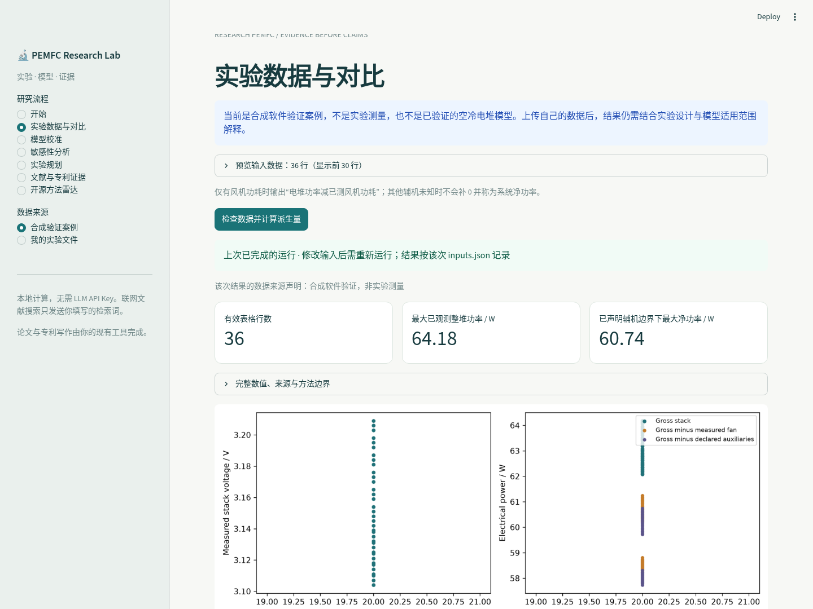

# Research PEMFC · 非写作科研工作台

面向氢燃料电池与空冷／开放阴极燃料电池，将**实验数据 → 可复核比较 → 模型校准 → 敏感性 → 下一轮试验**连接起来。文献和已有技术部分记录证据来源，结果可导出给你已有的写作工具。



## 直接使用

需要 Python 3.12 和 Git。核心计算在本机运行，无需 GPU 或 LLM API Key。

Windows PowerShell：

```powershell
git clone https://github.com/xiaoguai53/research-pemfc.git
cd research-pemfc
py -3.12 -m venv research-env
.\research-env\Scripts\python.exe -m pip install -r requirements-research.txt
.\research-env\Scripts\python.exe -m streamlit run app.py
```

Linux：

```bash
python3.12 -m venv research-env
research-env/bin/python -m pip install -r requirements-research.txt
research-env/bin/python -m streamlit run app.py
```

打开本机 `http://127.0.0.1:8501`。在左侧选择“我的实验文件”，上传 CSV／Excel 并映射列名。默认演示是明确标注的**合成软件验证数据**，不能当作实验结果。完整说明、参数单位、命令行和 MCP 配置见 [WORKBENCH.md](WORKBENCH.md)。

## 已实现的研究工作流

| 能力 | 实际交付 |
| --- | --- |
| 数据质量与功率边界 | 只读检查、缺失记录、整堆／扣风机／明确辅机边界的功率、CSV 与图 |
| 真实重复的条件比较 | 同负载匹配、重复内聚合、配对或 Welch、原单位效应与 95% 区间 |
| 原模型参数校准 | SciPy 有界优化＋原始 OPEM 点函数；R／lambda、逐行测温、完整组留出、残差与可辨识性 |
| 模型敏感性 | SALib Sobol 有序采样、原模型响应、首阶／总阶指数与置信估计 |
| 初始实验设计 | SciPy LHS、中心点重复、随机执行顺序、单位与待测表 |
| 下一轮候选 | Optuna 5 约束 ask/tell，保留已测不满足约束的试验，候选不附虚构结果 |
| 文献证据 | Crossref DOI 元数据／可用摘要、去重、访问级别和原始响应 |
| 已有技术查证 | 技术特征检索式、专利检索链接、待人工查证矩阵；没有新颖性判定 |
| 复现与导出 | 每次运行独立目录、输入哈希、方法／版本、PNG/SVG、CSV、JSON 和 ZIP |

MCP 提供原模型和八项新研究工具，共九项：

```bash
research-env/bin/python scripts/print_research_mcp_config.py --client codex
```

脚本只打印本机连接命令。也可以不打开界面，运行完整的离线合成验证流程：

```bash
research-env/bin/python scripts/run_research.py demo --output results/demo
```

## GitHub 高 Star 与周榜研究

已核对 20 个候选项目及 GitHub 官方周榜，并记录日期、累计 Star、实际周榜增量、许可和采用方式。详见 [调研与融合报告](docs/github-research-2026-11-14.md)。

- **实际调用**：SciPy、Optuna、SALib、Streamlit。
- **设计借鉴**：Scientific Agent Skills 的分析规范，autoresearch 的固定评估／实验记录，MLflow/DVC 的追溯原则，Auto Ontology 的数据语义与来源。
- **保留研究入口**：上游 Paper2Agent 完整 Skill；后续有论文和代码时，可逐篇转换并验证。

没有把“借鉴”标成已安装的第三方服务，也没有把自动写作模块加入产品。雷达页面和 `scripts/refresh_research_radar.py` 可按需刷新，未设置自动定时任务。

## 研究边界与证据

温度与膜水含量是给定／实测输入，当前没有空冷热水动态或 CFD 求解器。推荐工况的实际效果及输出约束要靠新测量确认。低拟合误差不等于物理参数已被唯一辨识；元数据不等于阅读全文；专利检索计划不等于已完成检索或新颖性判断。

新工作台的原始 API 参照、实现与独立验证、界面及安装验收保存在 `reports/workbench-v2/`。源模型仍固定于 OPEM 提交 `27d343fb966361a4e6cc99650241f651778fc50f`。验证平台是 Linux/Python 3.12；Windows 路径命令已提供，未声称完成 Windows 实机验证。

原 v0.1 单模型工具、锁定依赖与已验证的 [opem-mcp.zip](dist/opem-mcp.zip) 保持完整，其说明是 [USAGE.md](USAGE.md)，阶段记录对应原版本。原始数据放在 `research/inputs/`；界面上传与结果默认留在 `.workbench/`、`results/`，不进入 Git。

## 来源与许可

新集成代码使用 MIT。第三方实现由各自固定版本提供，详见 [THIRD_PARTY_NOTICES.md](THIRD_PARTY_NOTICES.md)。OPEM 软件 DOI：`10.21105/joss.00676`；Paper2Agent DOI：`10.1038/s41586-026-11044-y`。
