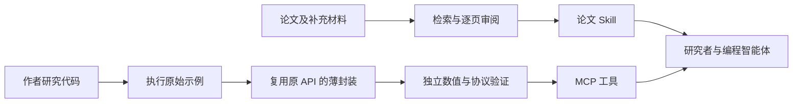

# Paper2Agent 项目研究与本项目的迁移方案

研究对象：[jmiao24/Paper2Agent](https://github.com/jmiao24/Paper2Agent)，固定版本 `8c2d059165ef8cdcb70dbea76655b9c2b55b38e6`。这里分析的是该版本的实际文件和工作流。论文：[Reimagining research papers as interactive and reliable AI agents](https://doi.org/10.1038/s41586-026-11044-y)。

## 核心设计

Paper2Agent 将论文中的知识和已有研究代码转化为编程智能体能够使用的材料。当前仓库的入口是 `skills/paper2agent/SKILL.md`，它按输入路由到两个组件：

| 输入 | 组件 | 可交付物 | 核心验证 |
| --- | --- | --- | --- |
| 论文 PDF、补充材料、表格、图片 | Paper2Skill | 连续正文、图表和可检索索引组成的论文 Skill | 逐页审阅、文件与坐标核对、严格验证 |
| 论文配套代码 | Paper2MCP | 可执行的 MCP 工具和安装包 | 直接运行原代码建立参照；独立验证薄封装；新环境和解压后实调用 |
| 两者都有 | 组合流程 | 论文 Skill + 经过测试的 MCP | 两个组件分别验证，通过后组合交付 |

多智能体的作用是把环境配置、工具选择、参照执行、实现和独立验证分开。尤其是验证者必须与实现者不同；“服务器能启动”也不能代替数值一致性检查。具体要求来自仓库的 `paper2mcp/references/orchestration.md`、`tool-selection-and-wrapping.md` 和 `runtime-verification.md`。

## 哪些部分值得迁移

1. **先建立可复现参照，再封装接口。** 对一篇燃料电池论文，先运行作者模型和官方输入，保存完整输出，再让工具处理自己的电堆参数。
2. **保留来源。** 记录论文 DOI、代码提交、原函数、参数单位和输入文件，避免以后无法判断曲线来自哪个模型。
3. **把会影响研究结论的参数开放出来。** 温度、气体分压、面积、膜厚、水含量等必须有明确语义，不能藏在示例常量里。
4. **把方法复现与研究解释区分开。** 与原程序一致只能说明忠实执行；能否描述自己的空冷电堆，需要实测数据和适用性检验。
5. **用真实 MCP 调用验收。** 包括正确输入、改变参数、错误输入和重复调用，且在新环境与迁移目录中重做。

## 本次具体落地

第一条可执行链路采用 [ECSIM/OPEM](https://github.com/ECSIM/opem)，固定提交 `27d343fb966361a4e6cc99650241f651778fc50f`，复用 `opem.Static.Amphlett.Static_Analysis`。选择依据是已有 Python API、官方 Amphlett 示例、单元测试以及无需外部实验数据和 GPU 的计算路径。

工具的科学计算仍由 OPEM 完成。本项目负责参数检查、可追溯输入输出、MCP 连接和交付验证。一个完整的极化扫描已经包含电压损失，因此没有把各项损失拆成重复工具。

本项目也保存了上游完整 `paper2agent` Skill，位于 `.agents/skills/paper2agent/`，并增加燃料电池研究入口 `.agents/skills/fuelcell-research/`。后续可对不同论文逐篇建立独立的 Skill 和模型工具，保持每篇论文自己的依赖环境。

## 实际限制

- 这个版本的 Paper2Agent 主要是编程智能体的 Skill 和工作流，需要能够运行命令并启动子智能体的宿主；它不是安装一个 Python 包就能自动完成所有转换的独立服务。
- 没有可执行代码的论文可先整理为论文 Skill。根据方程重新实现一个模型是新的研究实现，需要单独验证，不能标作原方法已经复现。
- OPEM Amphlett 是给定温度与水含量的静态模型。本次没有完成空冷热平衡、风机控制、膜水动态或三维温度场求解。
- 公开示例参数用于回归测试，不能直接当作用户电堆的已辨识参数。上游示例中的氧分压为 1 atm；这代表纯氧条件，不代表常压空气。

## 进一步研究的顺序

先拿一组自己的稳态极化数据做基线，再选择带代码的空冷热水管理论文。新增风量、环境湿度、吹扫、风机功耗等能力时，每一项都要找到对应的现成实现和可运行参照；不能只在 MCP 输入表里添加一个模型实际上没有使用的参数。

上游论文在 `Discussion` 中也强调：部分仓库因代码、数据、文档或环境不完整而不能成功转化；研究方向、机制解释和结论评估仍由研究者负责。
